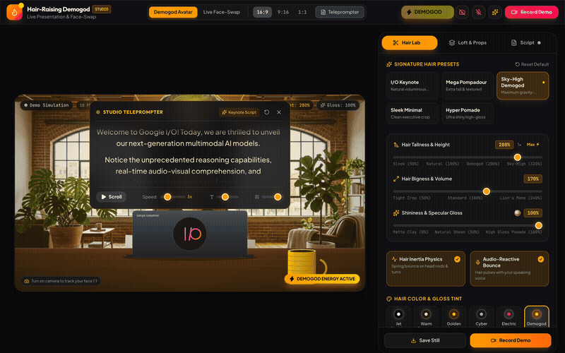
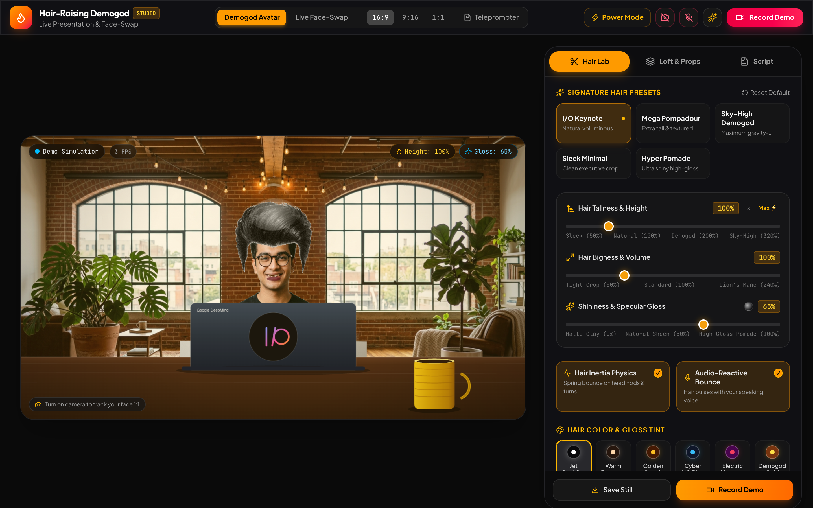
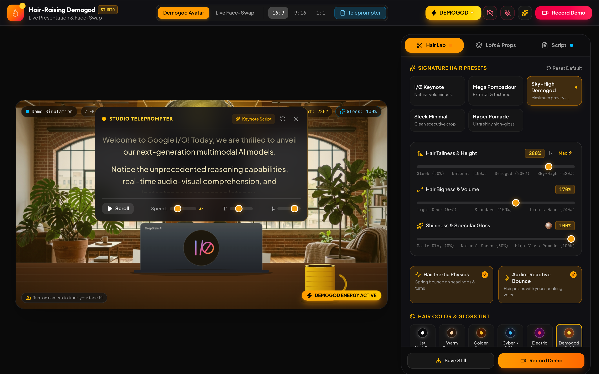
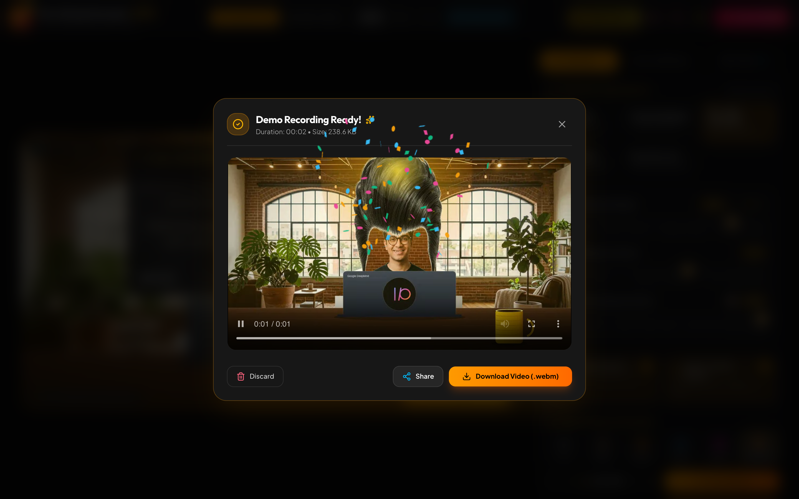

# Hair-Raising Demogod Studio 💈⚡



Turn any webcam presentation into a high-octane keynote demo featuring voluminous parametric hair, real-time head tracking, custom Brooklyn brick loft aesthetics, and instant video recording directly in Google Chrome.

---

## ⚡ Quick Start

```bash
# Clone the repository
git clone https://github.com/AndrewVoirol/ais-hair-raising-demogod.git
cd ais-hair-raising-demogod

# Install dependencies and launch studio
npm install
npm run dev
```

*Requires Node.js 18+.* Open `http://localhost:5173` in Chrome.

---

## 📸 Studio States

| Default Keynote State | Sky-High Demogod + Teleprompter | Instant Demo Recording & Export |
|---|---|---|
|  |  |  |

---

## 🎯 How It Works

1. **Turn on your Camera** (or use the built-in natural presenter motion simulation).
2. **Dial the Hair Controls**:
   - **Hair Height & Tallness**: Raise the signature pompadour up to 320% sky-high demogod elevation.
   - **Hair Bigness & Volume**: Expand horizontal density from sleek executive crop to lion's mane.
   - **Shininess & Specular Gloss**: Adjust anisotropic sheen highlights and diamond glint sparkles.
   - **Physics & Voice Reactive**: Enable spring inertia on head turns and audio-reactive hair bouncing when you speak into the microphone.
3. **Trigger Power Mode ⚡**: Activate the Super Demogod golden aura and electrical glints.
4. **Customize the Loft & Props**: Toggle Google DeepMind laptop (with rainbow I/O badge), yellow ribbed ceramic mug, glasses, background bokeh blur, and studio LUT color grading.
5. **Read the Built-In Teleprompter**: Keep your eyes locked to the lens with auto-scrolling keynote scripts.
6. **Hit "Record Demo"**: Capture crisp 60 FPS video + mixed microphone audio, review playback with confetti, and download instant `.webm` clips.

### Under the Hood
Hair-Raising Demogod combines **MediaPipe Face Mesh** 468-point 3D landmark tracking with a custom **60 FPS HTML5 Canvas compositor** and **Marschner anisotropic specular lighting**. Hair physics run on a second-order spring-damper inertia model with Web Audio API FFT frequency analysis for real-time voice reactivity. Studio recordings are mixed in-memory using `MediaStreamDestination` and the `MediaRecorder` API with zero cloud roundtrips.

---

## 🛠 Tech Stack

| Layer | Technology |
|---|---|
| **Framework** | React 19 + TypeScript |
| **Styling** | Vanilla CSS + TailwindCSS v4 |
| **Bundler & Tooling** | Vite |
| **Computer Vision** | MediaPipe Face Mesh (468 3D Landmarks) |
| **Audio Processing** | Web Audio API (Real-Time FFT Analyzer) |
| **Recording & Export** | MediaStream Canvas Mixer + MediaRecorder |
| **Icons & FX** | Lucide React + Canvas Confetti |
